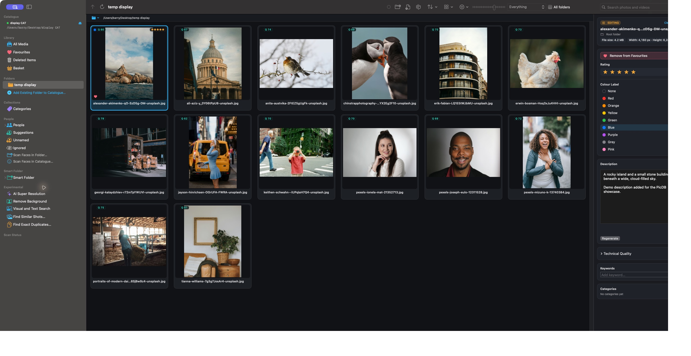
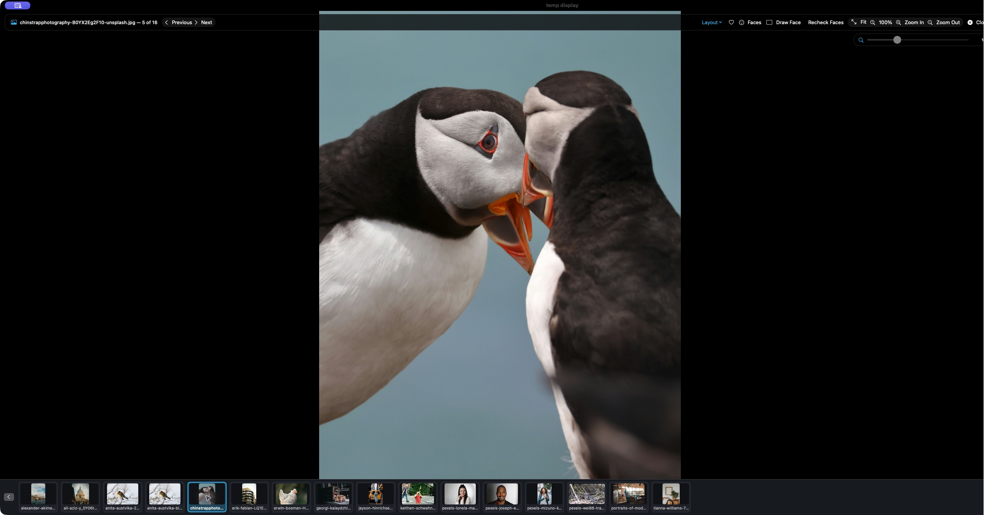
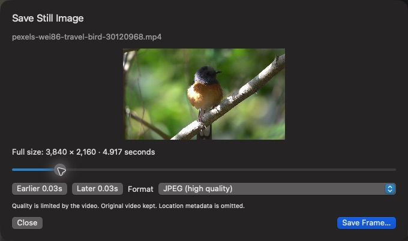
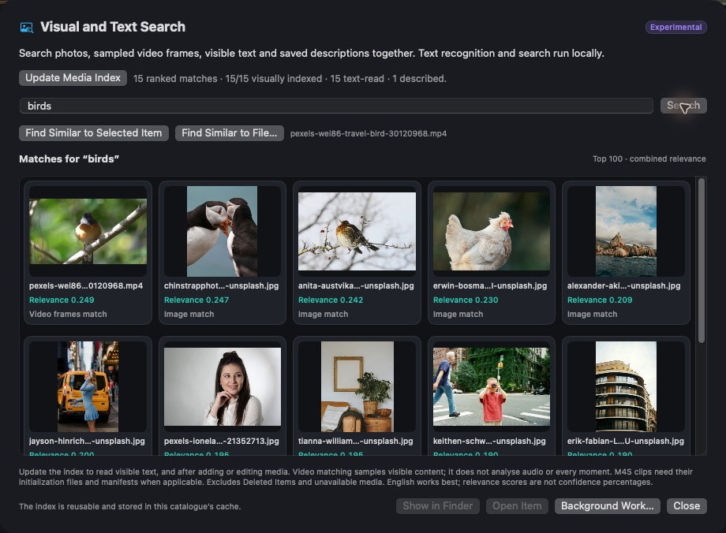
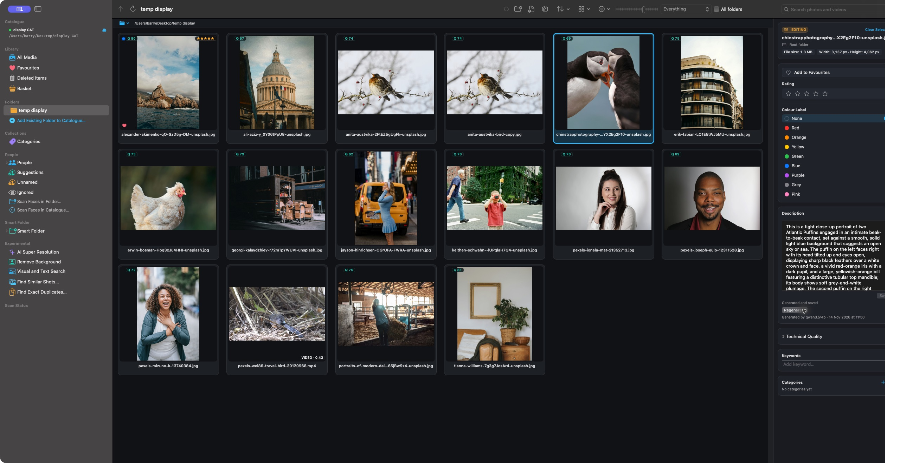
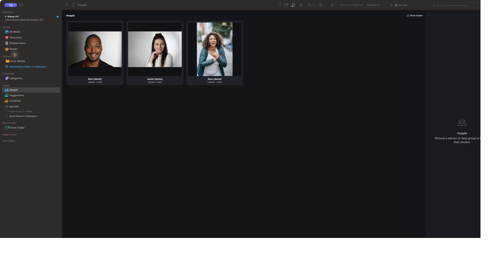
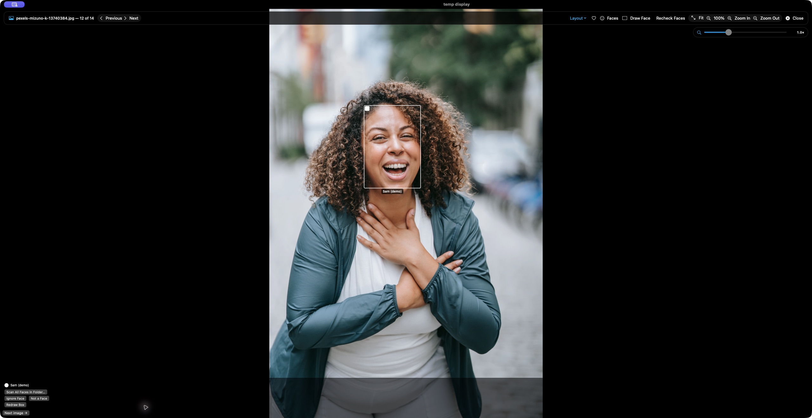
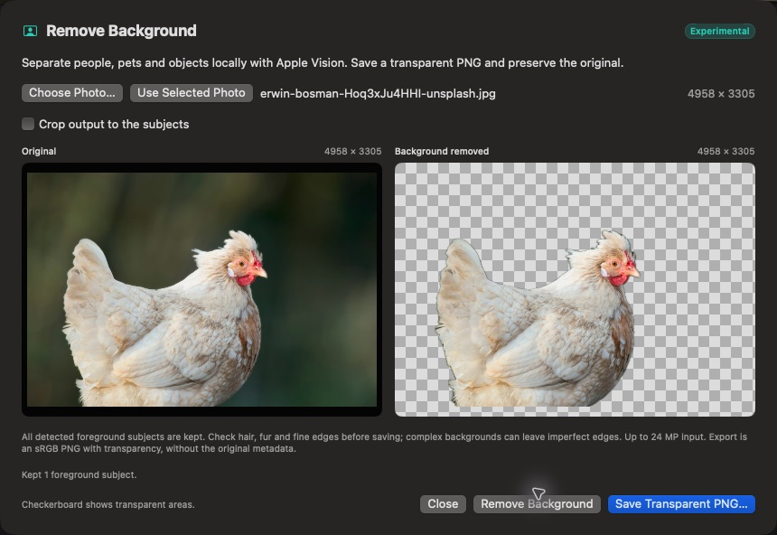
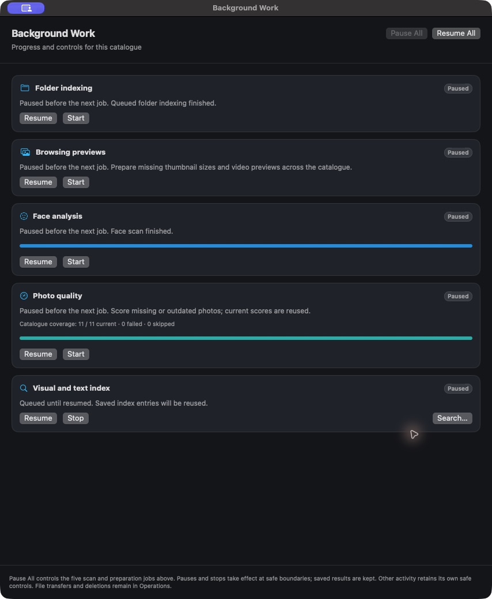
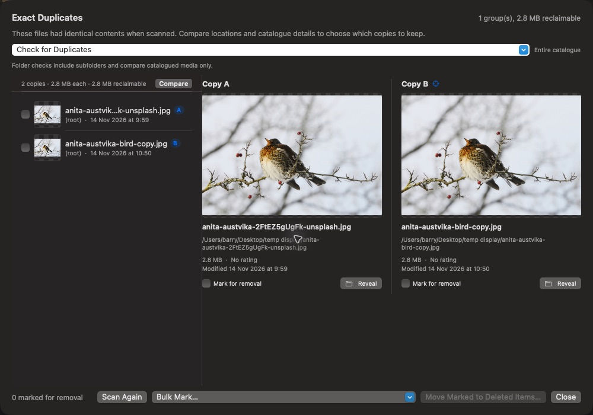

# PicDB

**My photo and video catalogue for macOS.**

I built PicDB to browse, organise and search my family photos (over 60k photos and 10k videos) in one place, while keeping control of the files and the work happening in the background.

This page is a look at what I've created. **PicDB is for my own use and isn't available to download.** This repository contains screenshots and documentation only.

## Browsing and organisation

I can add existing folders to a catalogue and browse them without having to bring everything into a new media library. The catalogue keeps track of organisation and analysis, while the photos and videos stay in their folders.

Ratings, favourites, colour labels, keywords, descriptions and categories give me several ways to organise a collection. Filters and saved searches help me get back to the things I want. The basket lets me gather files and folders for later work without making extra copies.

### A proper photo viewer

The viewer has fit-to-window and actual-size viewing, zoom, previous/next navigation, favourites and face labels. I've also paid attention to how large images are loaded, so browsing doesn't mean holding every original fully decoded in memory.

The **Folder thumbnails** layout keeps smaller previews along the bottom while the selected photo stays large. I can jump between pictures without closing the viewer or returning to the grid. There's also a **Same person** layout for browsing related photos through a named person.

### Videos belong in the same library

I can browse video files alongside photographs, play them with native macOS controls, move through the collection and save a frame as a separate image. Videos have duration badges and preview images chosen from inside the clip, rather than always showing the opening frame.

The still-image tool lets me choose a point in the video, make small adjustments and save a supported frame as JPEG or PNG while keeping the original video. Ratings, favourites and descriptions work with videos too.

I can also generate a video description from a sequence of sampled frames using the configured vision model. That describes the visible content in those samples, rather than transcribing audio or watching every moment.

## Searching by what's in a photo or video

Visual and Text Search lets me describe what I'm looking for instead of remembering a filename. It brings together image content, recognised text and saved descriptions, across both photos and videos.

Here, searching for **birds** returns the bird video alongside the bird photographs. The result labels show whether the match came from video frames or an image. I can also use a photo or video as a reference to find similar content.

The visual index and text recognition run locally, and the saved index can be reused. Video search uses sampled frames. These are relevance rankings to help me explore the collection, rather than confidence percentages.

## Small AI models, running locally

I've brought a few focused AI models into PicDB for different jobs:

- **CLIP ViT-B/32** connects visual content with words for visual search and similarity matching.
- **YuNet and SFace** handle face detection and recognition for the People workflow.
- **Qwen3.5:4b**, running through local Ollama, generates descriptions of photos and sampled video frames.

The face and visual-search models are bundled with the application. Description generation uses the vision model I run separately through Ollama on the same Mac. The description connection is restricted to local addresses, so the images aren't sent to a cloud description service.

### Generating descriptions

I can generate a description for one item, a selection or a folder, then review and edit the saved text. PicDB records which model generated it, and the description becomes another way to find that photo or video later.

The example above was generated locally from the puffin photograph using **qwen3.5:4b**. The description is stored in the catalogue; it doesn't alter the original image.

## People

I can name faces and browse a person's photos as a collection without moving the original files. Face detection and recognition run locally, with unnamed faces, suggestions, manual boxes, corrections and undo all part of the workflow.

I can add or adjust face boxes in the viewer and name them there. For folders dedicated to one person, there's also an optional folder-specific person setting.

The names in these screenshots are demo labels for stock photographs.

## Local image tools

I've included background removal using Apple Vision, with a side-by-side preview and a separate transparent PNG export. The original stays intact. There's also an experimental local super-resolution tool.

The quality badges in the library offer a technical estimate based on sharpness, noise and exposure. I use them as another way to sort and filter, rather than as a judgement of whether a photograph is good.

## Keeping background work under control

One of the parts I've spent time on is what happens while I'm using the application. Folder indexing, previews, face analysis, quality scoring and visual search all have work to do, but I still want to browse my collection and play a video.

The Background Work window shows progress, waiting reasons, pause/resume, stop and retry controls. I can leave jobs running while I browse, or pause the scan and preparation jobs together.

I've built this around a few practical decisions:

- Pauses happen between safe items, so a decoder can finish its current job.
- Stopping keeps completed previews and analysis available for the next run.
- Playback and visible previews take priority over queued background video work.
- Optional analysis is coordinated to avoid starting every expensive task at once.
- Closing a search window doesn't lose its indexing job.
- Switching catalogues waits for relevant work to stop safely before moving on.

File transfers and deletions have their own operation controls, separate from pausing background scans.

## Comparing duplicate files

Exact-duplicate review lets me compare copies side by side, including their locations, sizes and catalogue details, before choosing which to keep. Content hashes establish which files are identical, and the removal controls protect against marking every copy. Similar-shot discovery is a separate way to find related pictures for review.

## Looking after the files

I've put as much thought into file handling as browsing. Deleting something normally moves it into PicDB's **Deleted Items**, where I can review and restore it with its catalogue information.

When files need to move between volumes, PicDB verifies the copy before removing the source. Occupied destinations aren't silently overwritten. File operations keep a journal for recovery, and permanent deletion has its own review and ownership checks.

Catalogue backups are validated snapshots of the catalogue data. They're separate from backing up the original photos and videos. I've also accounted for offline drives, so an unavailable drive isn't treated as proof that its files have disappeared.

## How I've built it

I've used AI as a development tool throughout the project but I've also spent a lot of time deciding how I want the application to behave, working through edge cases and refining the way the features fit together. The background controls, recovery workflows and care around original files are a big part of that.

PicDB is built with Swift, SwiftUI and AppKit, with SQLite through GRDB for the catalogue. It uses Apple's media and imaging frameworks, Apple Vision, and ONNX Runtime for local face and visual-search models.

## Image and video credits

Thank you to **Unsplash and its photographers** for the sample photos, and to **Pexels and its contributors** for the portraits and bird video used in these screenshots.

[Full credits and sources](CREDITS.md)

---

**This is a showcase of my own application, not a software release. No download or source code is provided.**
